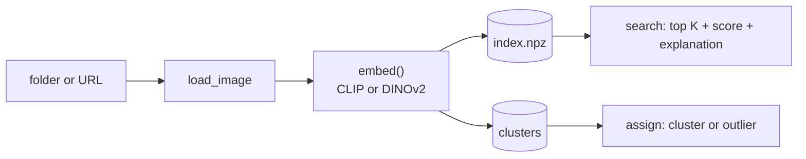

# vsim: a small visual similarity engine

**Point it at a folder of images. Find look-alikes, and get named clusters, on a laptop CPU.**


This is the worked take-home example for the AUEB MSc Data Science careers lecture. There are
two decks: career options ([HTML](slides/aueb_data_science_careers.html),
[PDF](slides/aueb_data_science_careers.pdf)) and the interview example
([HTML](slides/vsim_interview_example.html), [PDF](slides/vsim_interview_example.pdf)), which
explains the assignment and walks through this repo. It is small enough to read in an
evening, and every design claim is backed by an experiment you can re-run.

## What it does

**🔎 Search.** Query with any image (a path or a URL) and get the most similar images,
each with a **score in [0, 1]** and an **explanation** of what they share:

```console
$ vsim search dress.jpg -k 3 --index index.npz     # a dress that is not in the index
611584005  0.715  both: close-up of a product, dress, blue, floral; different format (studio product photo vs sale banner)
707363002  0.602  both: studio product photo, floral; different format (studio product photo vs sale banner)
569523002  0.523  both: studio product photo, close-up of a product, floral
```

**🗂️ Cluster.** Group the folder into **automatically named** clusters (it picks K
itself), then file new images into a cluster, or flag them as **outliers**:

```console
$ vsim cluster data/images                          # 996 H&M photos
ds_f2e779a3d6f530eb
$ vsim clusters ds_f2e779a3d6f530eb                 # K=7, chosen automatically (trimmed)
[1] studio product photo: jewellery & handbag  (n=116)
[2] studio product photo: sneakers  (n=45)
[3] studio product photo: dress & tunic  (n=203)
[5] studio product photo: bra & underwear briefs  (n=83)
[6] close-up of a product: shorts & trousers  (n=136)
...
$ vsim assign sneaker.jpg ds_f2e779a3d6f530eb      # a sneaker that was not clustered
studio product photo: sneakers
```

Real output on 996 H&M catalogue photos (IDs are H&M article ids), on a laptop CPU:
indexing took about 12 s. The two queries were held out of the folder.

## How it works



- **One path for everything.** Indexing, querying, clustering and assignment all decode
  and embed images the same way, so queries can never drift from the index
  (train/serve skew).
- **Brute-force cosine.** One matrix-vector product per query. Below about 10⁵ images
  a vector database is not worth it.
- **Scores that mean something.** 0.9 means "more similar than 90% of real neighbour
  pairs in this catalogue". The ranking is unchanged.
- **K chosen by stability.** K-means for K = 4–12, keeping only the K values that
  give the same clusters whatever the random seed; cluster names come from
  zero-shot CLIP tags.

The reasoning behind each choice is in [docs/](docs/README.md).

## Quick start

You need [uv](https://docs.astral.sh/uv/); it installs Python 3.12 for you. **New to the
terminal, or on Windows?** Follow [docs/getting-started.md](docs/getting-started.md): it
goes step by step from installing VS Code to your first search.

```bash
git clone https://github.com/stamtron/aueb-visual-similarity-engine.git
cd aueb-visual-similarity-engine
uv sync
uv run pytest -q                                    # ~2 s, no downloads

uv run vsim index path/to/images --out index.npz    # first run downloads CLIP (~350 MB)
uv run vsim search path/to/query.jpg -k 5 --index index.npz

uv run vsim cluster path/to/images                  # prints a dataset id: ds_...
uv run vsim assign path/to/new.jpg ds_...
```

Any folder of images works; file names become IDs (`123.jpg` → `123`). For the reference
dataset, a 1000-image sample of the H&M catalogue from Kaggle, follow
[docs/data.md](docs/data.md). It takes three commands and works on Windows too.

The full CLI, the Python API and the settings are in [docs/usage.md](docs/usage.md).

## The interesting part

**CLIP reads text.** It was trained on image–caption pairs, so on catalogue images with
overlay text it can match the *banner* instead of the product. We stamp the same
"SALE -50%" strip on 50 products and query with 50 other bannered products, then
measure fixes on 998 H&M photos, against the catalogue labels (CPU):

| configuration | a bannered stranger beats the real match | same product type in top 5 | time to embed the folder |
|---|---|---|---|
| CLIP (baseline) | 10% of queries | 0.55 | 8 s |
| CLIP + text masking (OCR + inpainting) | 4% | 0.55 | 110 s (~13× slower) |
| DINOv2 (image-only, self-supervised) | **0%** | **0.62** | 13 s |

Masking also stops the engine from flagging some junk inputs: blank-after-inpainting
looks like a white studio shot. CLIP stays the default because its zero-shot tags power
the explanations and the cluster names, and it groups better by colour; DINOv2 is one
flag away (`--model dinov2-s14`).

How we evaluate, with and without labels, and what we found:
[docs/evaluation.md](docs/evaluation.md).

## Documentation

| doc | read it for |
|---|---|
| [getting-started.md](docs/getting-started.md) | step-by-step setup on Windows or macOS with VS Code, for terminal beginners |
| [usage.md](docs/usage.md) | install options, every command, the Python API, settings |
| [data.md](docs/data.md) | getting the H&M sample (or a no-account alternative) |
| [architecture.md](docs/architecture.md) | modules, on-disk formats, repo layout |
| [search.md](docs/search.md) | retrieval, the [0, 1] score, explanations, outliers |
| [clustering.md](docs/clustering.md) | choosing K, naming clusters, assignment |
| [evaluation.md](docs/evaluation.md) | evaluating without labels, and with them |
| [decisions.md](docs/decisions.md) | trade-offs, known limitations, what we would do next |
| [AGENTS.md](AGENTS.md) | contributing: conventions and the invariants the code relies on |

## License

[MIT](LICENSE). The H&M images are not included and are subject to the
[competition rules](https://www.kaggle.com/competitions/h-and-m-personalized-fashion-recommendations/rules).
